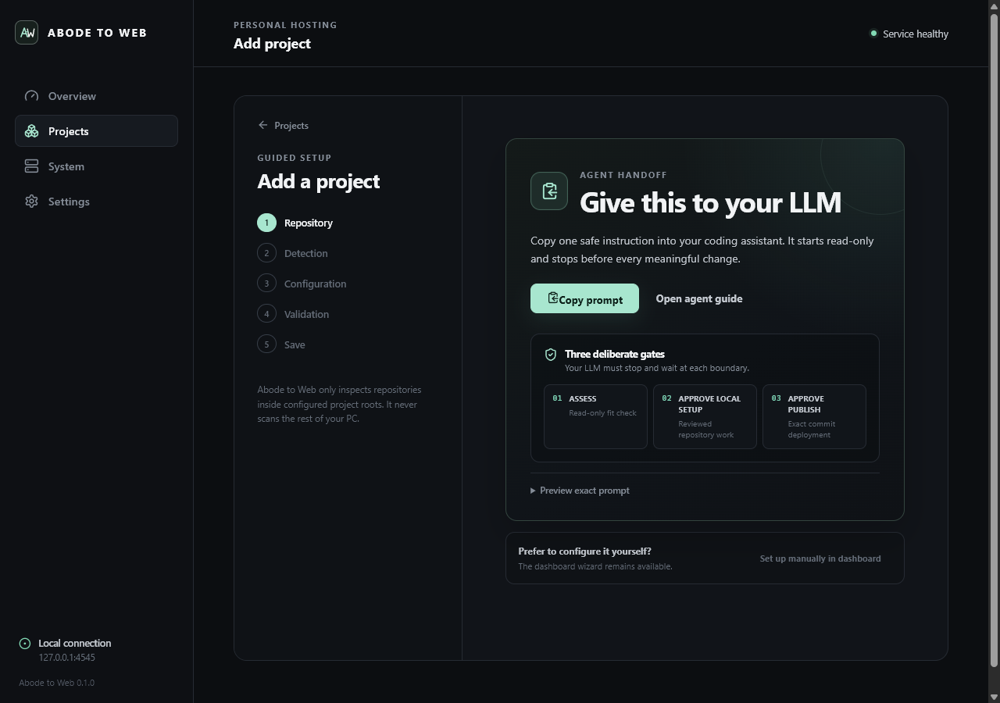

# Abode to Web

[](https://github.com/eversko/abode-to-web/actions/workflows/ci.yml)
[](LICENSE)
[](docs/INSTALLATION.md)

**Windows-first, health-gated Git releases for one machine.**

Abode to Web turns a Windows PC or server into a small, understandable application platform. It prepares an exact Git commit in an isolated release directory, checks the candidate, and switches routing only after the activation gate passes. Stable static releases remain available for rollback.



The stable path serves **committed, prebuilt static output** and runs no project install, build, or start command. It needs no Docker, IIS, WSL, Linux VM, or long-running Node process. Any project command—including a build for a static site—and every Node, command, or Docker Compose adapter require the explicit `experimentalProjectExecution` opt-in.

## Give this to your LLM

Paste this into any code-capable LLM from the repository you want to deploy:

```text
Read https://github.com/eversko/abode-to-web/blob/main/docs/AGENT-QUICKSTART.md and follow it for this repository. Start with ASSESS only: inspect read-only, report whether the project fits Abode to Web, and show the exact plan. Do not install, elevate, edit files, handle secrets, deploy, publish, or change DNS, firewall, router, or power settings. Stop and wait for my explicit APPROVE LOCAL SETUP message. After local verification, stop again and wait for my separate APPROVE PUBLISH message.
```

The [agent quickstart](docs/AGENT-QUICKSTART.md) is provider-neutral: it works as an instruction contract for Codex, Claude Code, Cursor, or another code-capable LLM. It separates three decisions:

1. **ASSESS** — read-only inspection and an exact plan.
2. **APPROVE LOCAL SETUP** — repository-local preparation and non-elevated verification only.
3. **APPROVE PUBLISH** — deploy the reviewed commit through Abode to Web. DNS, firewall, router, power, secrets, and administrator actions remain separate decisions.

Prefer the dashboard? Install Abode to Web, open <http://127.0.0.1:4545>, and choose **Projects → Add project**. New projects start with routing disabled and test builds off.

## Why Abode to Web

- **Reversible stable path:** an invalid static candidate never replaces the current route; retained static releases can be rolled back.
- **Exact Git releases:** deployment resolves a configured remote and branch to a commit, then works outside the development checkout.
- **Windows-native operation:** the control plane runs as a Windows Service. Stable static releases execute no project code on the host.
- **Endpoint-attested dynamic routing:** experimental process-backed candidates activate only after Abode to Web proves their loopback listener belongs to the supervised Windows Job; active managed routes repeat that proof during health checks.
- **Private control surface:** the dashboard binds to loopback and uses the authorized Windows session; the public gateway is a separate listener.
- **Reviewable configuration:** desired state lives in YAML, operational state in SQLite, and long actions produce durable progress and logs.
- **Cloudflare-friendly, not Cloudflare-dependent:** Abode to Web can generate tunnel ingress guidance, but it does not silently change DNS or account resources.

Abode to Web deliberately does not provide a browser terminal, arbitrary remote command endpoint, multi-tenant accounts, billing, Kubernetes, or a public dashboard password.

## Choose Abode to Web when

Choose Abode to Web when you want a Windows-local controller that promotes a reviewed Git commit to one machine through a health gate and reversible static routing. Choose managed static hosting for fully managed delivery, a general dashboard for visibility, or container orchestration when you need multi-service container operations. Abode to Web is intentionally not a multi-tenant PaaS or a browser terminal.

## Release flow

```text
exact Git commit
       │
       ▼
committed static output ── servable-output gate ── switch loopback route
       │                         │
       └─ missing/invalid ───────┘ keep current release
```

The dashboard/API listens on `127.0.0.1:4545`. Public hostnames, when deliberately enabled, reach the separate loopback gateway on `127.0.0.1:4580`, commonly through Cloudflare Tunnel.

## Installation

A release ZIP is self-contained. Running Abode to Web requires Windows 10/11 or current Windows Server, PowerShell 7, and Git. Building Abode to Web itself from source additionally requires .NET 10 SDK and Node.js 22.12 or newer.

Start with [Installation](docs/INSTALLATION.md). The installer does not change firewall, router, DNS, or power settings. It asks for administrator elevation only for the Windows Service and protected machine-wide directories.

## Project support

| Configuration | Status | Best use |
|---|---|---|
| Static + committed output + no project commands | **Preview / validated on one Windows host** | Vite builds, static exports, documentation, portfolios, demos |
| Static + install or build command | Experimental | Mutually trusted projects that must build on the host |
| Node or command adapter | Experimental | Mutually trusted long-running applications |
| Docker Compose adapter | Experimental / not activation-ready | Configuration experiments only; external listeners cannot pass the Windows Job ownership gate |

`experimentalProjectExecution` is false by default and is machine-wide. When enabled, all install, build, and start processes use the shared `AbodeToWebRuntime` Windows identity. Those applications therefore form **one Windows trust domain**: do not co-host command-executing projects that do not fully trust one another.

In v0.1, execution-bearing releases are fresh-deploy only. Automatic restart and retained start, restart, rollback, or recovery are intentionally unavailable until Abode to Web has sealed artifacts. Prebuilt static releases retain normal rollback.

Docker Compose listeners are owned outside Abode to Web's supervised Windows Job. A Compose candidate therefore fails closed and is cleaned up instead of activating a route.

## Repository map

```text
src/AbodeToWeb.Server/          ASP.NET Core host, API, dashboard delivery
src/AbodeToWeb.Core/            domain model and reliability policies
src/AbodeToWeb.Infrastructure/  SQLite, Git, processes, health, proxy, logs
src/AbodeToWeb.Web/             React + TypeScript dashboard
tests/                             unit, integration, web, and smoke fixtures
config/                            reviewed example manifests
scripts/                           installation, service, backup, and tunnel tools
docs/                              architecture, operations, and security guidance
```

## Documentation

- [Agent quickstart](docs/AGENT-QUICKSTART.md)
- [Installation](docs/INSTALLATION.md)
- [Add a project](docs/ADDING_A_PROJECT.md)
- [Architecture](docs/ARCHITECTURE.md)
- [Daily operations](docs/OPERATIONS.md)
- [Backup and restore](docs/BACKUP_AND_RESTORE.md)
- [Cloudflare Tunnel](docs/CLOUDFLARE.md) and [domains](docs/DOMAINS.md)
- [Security](docs/SECURITY.md), [threat model](docs/THREAT_MODEL.md), and [roadmap](docs/ROADMAP.md)
- [Troubleshooting](docs/TROUBLESHOOTING.md)

## Security and license

Abode to Web is a privileged local control plane, not a claim of perfect security. Keep the dashboard on loopback. Prefer the execution-free static path; if experimental execution is enabled, run only mutually trusted project code and review every command. Report suspected vulnerabilities through [SECURITY.md](SECURITY.md).

Abode to Web is licensed under the [Apache License 2.0](LICENSE). See the [license decision](docs/LICENSE_DECISION.md), [third-party notices](THIRD_PARTY_NOTICES.md), and [research acknowledgements](docs/RESEARCH.md).
